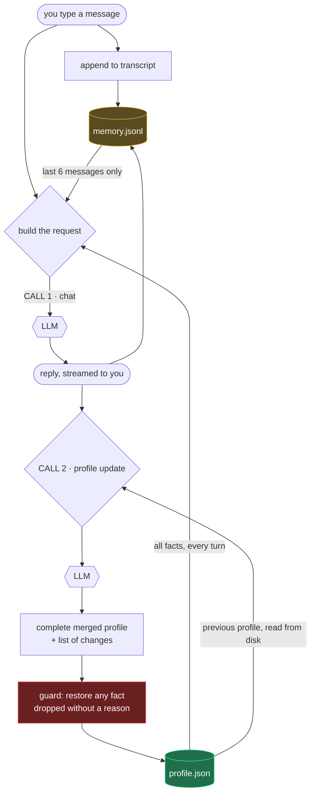
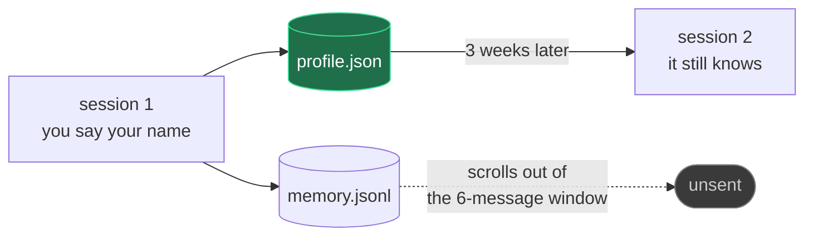

# How the chatbot remembers you

Two files, two lifetimes, two API calls per turn. That's the whole design.

| | `memory.jsonl` — the transcript | `profile.json` — the profile |
|---|---|---|
| holds | every message, verbatim | durable `key: value` facts |
| grows | forever | stays ~5–10 lines |
| sent | last 6 messages only | **all of it, every turn** |
| lifetime | disposable | permanent |
| written | as each message happens | by a dedicated LLM call |

---

## One turn, start to finish



**The two calls do different jobs.** Call 1 answers you. Call 2 does nothing you
can see — it reads the profile as it exists on disk, looks at what was just
said, and returns the *whole* updated profile plus a list of what it changed.

## Why there's a guard

Call 2 rewrites the entire record. A model can delete a fact just by not
repeating it. So: anything that disappears without being listed in `changes`
gets put back, with a warning. **Omission is not deletion.**

## What survives



Delete `memory.jsonl` entirely and the bot still knows your name, your city and
that you want Python examples. That is the point of the profile.

## The trade, in real numbers

Measured on a 4-turn session (`gpt-5.6-terra`, class proxy):

```
chat    ×4   653 tokens     ← answering you
profile ×4  1964 tokens     ← maintaining the memory
```

- **Write path costs.** ~490 tokens/turn, because the merge instructions plus
  the whole profile ship every time. `MAI_PROFILE_EVERY=3` cuts it to a third.
- **Read path saves.** A 25-token profile stands in for a transcript that grows
  without limit — and it never gets bigger as the conversation does.

## The catch worth discussing

`/forget location` removes the fact from `profile.json` — and it stays gone.
But the last 6 messages still mention Chennai, so the bot may still say
"Welcome to Chennai!" until those scroll away.

**Deleting from durable memory is not deleting from context.** Any real system
that promises "delete my data" has to handle both.

---

*Code: [`chatbot.py`](chatbot.py) — the policy that decides what's durable is
the prompt at `PROFILE_SYS`, line 122. It's English. Edit it.*
